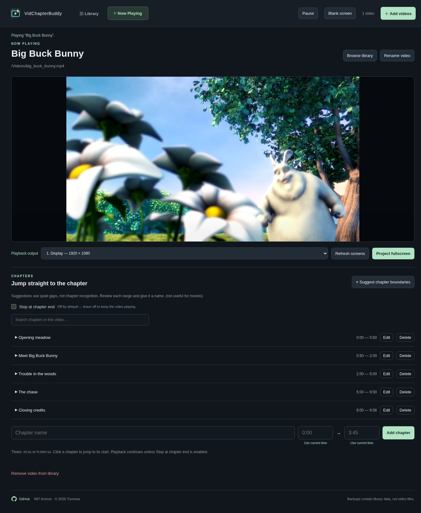

# VidChapterBuddy

A desktop video library with friendly names, searchable chapters, and fullscreen projection. Built with Tauri 2 for Linux, Windows, and macOS.



*Demo library with manual example chapters. Film image: © 2008 Blender Foundation / [www.bigbuckbunny.org](https://www.bigbuckbunny.org/), [CC BY 3.0](https://creativecommons.org/licenses/by/3.0/). [Film attribution details](https://peach.blender.org/about/).*

## Downloads

Get packaged installers from [GitHub Releases](https://github.com/Tryomas/VidChapterBuddy/releases): Linux AppImage/DEB/RPM, Windows setup EXE, and macOS universal DMG. Installers appear after all platform builds succeed; each release includes SHA-256 checksums. Repository access is required while the project is private.

## Run

Install Node.js 24, npm, current stable Rust with Cargo, and the [Tauri prerequisites for your operating system](https://v2.tauri.app/start/prerequisites/). Windows requires the MSVC build tools and WebView2, macOS requires Xcode command line tools, and Linux requires WebKitGTK and GStreamer. SQLite is compiled into the app. Chapter suggestions and compatibility previews can use an existing FFmpeg installation or an optional download offered on first use.

```sh
npm ci
npm run tauri dev
```

`npm run build` checks TypeScript and builds the frontend. `npm run tauri build` builds the desktop application.

## Use

Add videos, then rename them with a friendly title. Original files are referenced in place and never modified. Formats that cannot play directly can use a cached compatibility preview. Library metadata and Autoplay are saved in `library.sqlite` in the OS app data directory for `com.vidchapterbuddy.desktop`. Keep source videos in their original locations.

Open **Library** to browse the video grid. Click a video to switch to the larger **Now Playing** tab. **Autoplay videos selected from the library** is off by default, so the video loads paused until you press Play. Enable the checkbox in Library to start selected videos or chapter search results automatically; the setting is remembered on this computer. Switching back to Library leaves playback running.

To mark a chapter, enter a name, start and end time; use either current playback time button or type m:ss / h:mm:ss. Edit or delete markers at any time. Click a chapter to jump to its start. **Stop at chapter end** is off by default each time you open the app, so playback continues through the rest of the video. Enable the checkbox in Now Playing to pause at the end of a selected chapter. Changing the checkbox also applies to a chapter already playing, including during projection. Search matches video and chapter names.

“Suggest chapter boundaries” runs local FFmpeg silence detection at -35 dB for gaps of at least 1.5 seconds and suggests non-silent ranges at least 15 seconds long. Review and name the results before using them. This does not recognize chapter titles and cannot reliably separate continuous music, applause, or crossfades; manual markers are always available. Repeated analyses may add duplicate suggestions. No videos are uploaded.

## Supported formats

Import MP4, M4V, MOV, MKV, WebM, AVI, WMV, MPEG, MTS/M2TS, TS, VOB, OGV/Ogg, 3GP, FLV, ASF, MXF, and other video formats listed in `src/formats.ts`. Direct playback depends on the codecs available in the operating system's webview. When needed, FFmpeg creates a compatible cached preview after you approve it; support for a particular codec depends on the installed FFmpeg build. HEIC and HEIF images are not supported.

FFmpeg setup is optional and offered on first use if no working installation is found. Downloads are pinned and checksum-verified. Videos are processed locally. Analysis and conversion can be canceled; see [SECURITY.md](SECURITY.md) for processing and cache limits.

The **Blank screen** button hides the picture while playback and audio continue, both within the app and during projection. **Show video** restores it.

## Validation

```sh
npm run build
npm test
cargo test --manifest-path src-tauri/Cargo.toml --lib
```

The optional real-conversion smoke test is ignored unless explicitly requested. To run it, set `VIDCHAPTERBUDDY_TEST_FFMPEG` to a working FFmpeg executable and add `-- --include-ignored` to the Cargo test command. Browser interaction and actual Linux playback have also been checked locally; Windows/macOS runtime and monitor placement still require testing on those systems.

## Fullscreen projection

Select a screen under **Playback output**, then click **Project fullscreen**. The video opens in a dedicated fullscreen window with black letterboxing and no library UI. The main app becomes the controller: play/pause, seek, volume, mute, and chapter markers act on the projection. Only the projection plays audio; the in-app player is paused.

Click **Play within app**, or press Escape on either window, to return at the current playback position. Space on the projection toggles play/pause. Changing or removing the selected video closes the projection first. **Refresh screens** updates connected displays; disconnecting the active screen returns playback to the app. Projection requires Tauri 2.12+ for selecting the fullscreen monitor. Actual monitor placement depends on the desktop compositor and must be tested on the target display setup.

## Library folders, search, and sorting

- **New folder** creates a library folder in the folder you are browsing. Folders can contain subfolders. Click a folder to open it and use the breadcrumb to go back. **Show all videos** includes videos from every folder.
- Each video card has a red **×** button to remove it from the library after confirmation. This also removes its chapter markers, but keeps the original video file.
- Each video card has a **Folder** selector to move it between library folders. Rename or delete folders from their cards. Deleting a folder moves its videos and subfolders up one level. Source video files are never moved or renamed.
- Library search matches friendly video names, filenames, and chapter names across all folders. Matching chapter markers appear on the cards; click a chapter to switch to Now Playing and jump to its start. Now Playing also has a search field for chapters in the current video.
- Sort by **Friendly name**, **Filename**, **Date added**, or **File modified date**, ascending or descending. Filenames use natural ordering (set2 before set10). Unknown legacy import dates appear last; file modified dates are read from source files when the library loads.
- Existing JSON libraries migrate automatically into SQLite on first use, preserving video names, chapter markers, and folders. Original JSON files remain untouched. Once the database exists it is authoritative; older app versions that still write JSON should be closed.

Frontend tests cover search, sort, folders, timestamps, and chapter playback helpers. Rust tests cover SQLite migration and round trips, transactional rollback, portable backups, restore safety snapshots, invalid backup rejection, window permissions, HTTP media ranges, FFmpeg integrity, process limits, and legacy data compatibility.

## Linux playback

Install the GStreamer playback plugins as well as WebKitGTK. On Arch: `sudo pacman -S --needed gst-plugins-base gst-plugins-good gst-libav`. FFmpeg alone does not provide GStreamer's playback plugins.

Playback uses a loopback-only HTTP stream with an unpredictable session token. Only videos registered from the library can be streamed. This avoids WebKitGTK's custom asset-scheme media-loading problem and supports seeking without loading whole movies into memory. Videos stay on the computer.

## Back up and restore

Use **Backup** in Library to save a portable `.sqlite` snapshot. It includes folders, video paths and friendly names, chapter ranges, and the Autoplay setting. Backups contain metadata, not the video files or generated previews.

Use **Restore** to select a backup. The app validates the SQLite file before asking for confirmation, then saves a `library-before-restore-<id>.sqlite` safety backup in its app data folder and replaces the library transactionally. Canceling or rejecting an invalid backup leaves current data unchanged. Video files must still exist at their saved paths, including when moving to another computer.

SQLite is bundled with the app; no separate database installation is required. The active file is `library.sqlite`. The Backup button creates a consistent standalone snapshot even while the app is running. If copying the active database manually, close the app first. Libraries and backup imports are limited to 64 MiB of database storage, 100,000 videos or chapter markers, and 4,096 folders.

## License and source

VidChapterBuddy is [MIT licensed](LICENSE). Third-party dependencies and the optional FFmpeg download retain their own licenses and notices. Source repository: [Tryomas/VidChapterBuddy](https://github.com/Tryomas/VidChapterBuddy) (private; requires access). The app footer opens this fixed URL in your default browser.

Pushes to `main` build installers and publish a private GitHub Release. Branch pushes and PRs do not build releases; merging a PR into `main` does. See [DISTRIBUTION.md](DISTRIBUTION.md) for versioning, release downloads, and retry behavior.

The editable icon is `src/assets/vidchapterbuddy.svg`. Generate desktop icons with `npm run tauri -- icon src/assets/vidchapterbuddy.svg --output src-tauri/icons`.

## Release versions

The root [version.txt](version.txt) contains the major/minor base, currently `1.0`. The commit establishing that base is `1.0.0`; each subsequent first-parent commit on `main` increments the patch (`1.0.1`, `1.0.2`, …). A PR merge counts once, regardless of its internal branch commits. Multiple commits pushed together advance the counter by that many mainline commits. Rerunning the same SHA retains the same version.

CI stamps the calculated version into the npm, Cargo, lockfile, and Tauri manifests without creating version-bump commits. The checked-in manifests use the development base (`1.0.0`). Raise `version.txt` to a higher base, such as `1.1`, to start a new series at `1.1.0`; do not reuse an earlier base.

`node scripts/release-version.mjs` previews the version for the current commit. Add `--write` to stamp the local manifests before a manual build. The initial workflow setup commit uses `[skip ci]`; merging the follow-up PR triggers the first `1.0.1` release.
